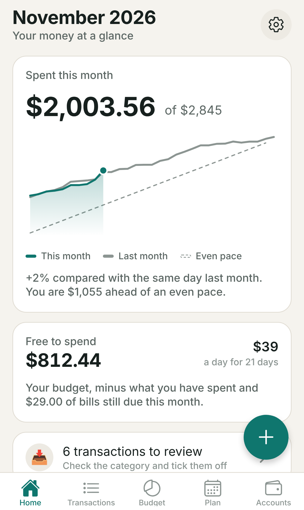
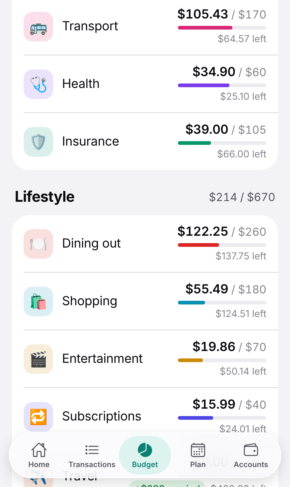
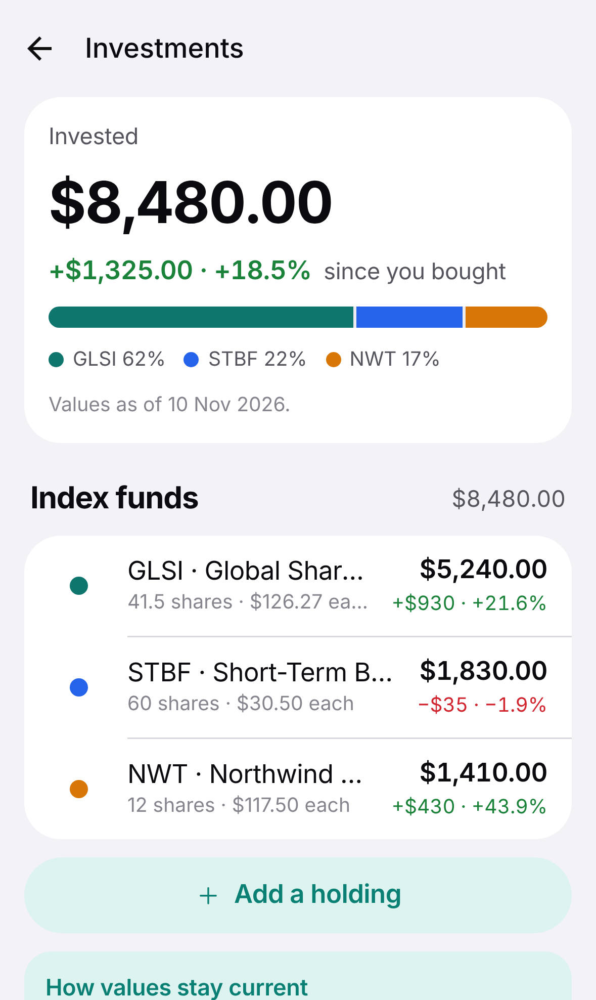
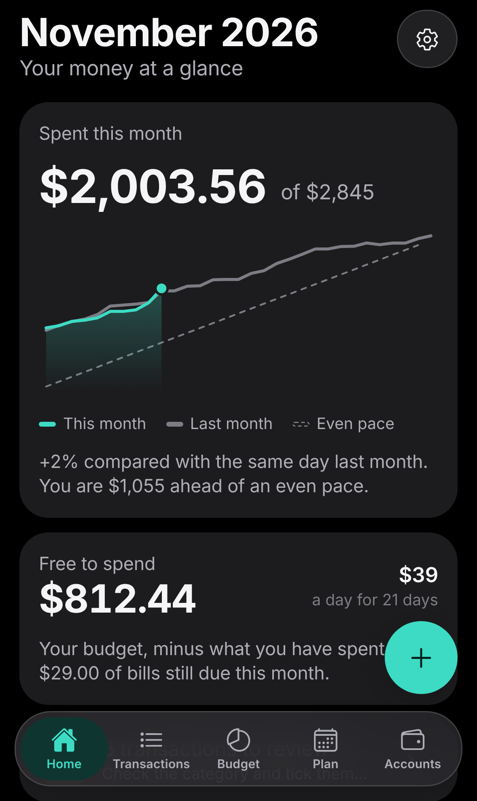

# Waypoint

A personal money tracker for iPhone. It covers what the best budgeting apps do (spending, budgets, bills, net worth,
investments, goals) and is built around the things they tend to get wrong: it works with any bank in any currency, it
plans ahead instead of only looking back, and your data lives on your phone.

<p>
  
  
  
  
</p>

Waypoint started as a study of [Copilot Money](https://copilot.money): what it does well and where its users say it
falls short. The findings, with sources, and how each one is addressed are in
[docs/copilot-teardown.md](docs/copilot-teardown.md). Waypoint is an original app, not a copy: it shares no code, name
or artwork with Copilot.

## What it does

- **Transactions.** Add by hand in a few taps, import a CSV export from any bank, or connect a bank and let them
  arrive by themselves. Search across payee, notes, tags and amounts; filter; select several and categorise them
  together; export exactly what you filtered.
- **Bank connections.** Transactions, balances and investment holdings sync straight from the bank service to the
  phone, with no Waypoint server in between. See [docs/bank-sync.md](docs/bank-sync.md) for how it works, what it
  needs and where its limits are.
- **Investments.** Holdings with current value, gain since purchase and allocation, from a connected brokerage or
  entered by hand.
- **Budget.** Category budgets with rollover. Change a budget for one month or from now on; past months never change.
  Track spending against limits, or switch to planning every unit of income.
- **Bills and income.** Weekly to yearly schedules, found in your history or added by hand. Mark paid or skip in two
  taps; payments that arrive later are matched automatically.
- **Forecast.** Your cash balance projected day by day for up to 90 days, with a warning before it runs short.
- **Goals and debt.** Savings goals that say how much to put aside each month, and a payoff plan for cards and loans.
- **Accounts and net worth.** Any mix of currencies, converted with rates you set.
- **Rules.** Tidy up transactions automatically, with every rule visible, editable and reorderable.
- **Your data.** Stored on the device. One-file backup and restore. No Waypoint account, no subscription.

## How it looks

The interface follows Apple's current design language, Liquid Glass. Content is calm and opaque on a grouped
background. Navigation and controls float above it on glass: the tab bar, toolbar buttons, the add button, sheets and
toasts. On iPhone the tab bar is the system's own, icons are SF Symbols, amounts use rounded numerals, and selections
and saves give haptic feedback. The real glass material needs iOS 26 or later; older iPhones, Android and browsers
get a translucent stand-in with the same layout.

## Run it

Developed and tested with Node 22.

```bash
npm install
npx expo start
```

- **On your iPhone:** install Expo Go from the App Store and scan the QR code. Phone and computer need to be on the
  same network.
- **In the iOS Simulator (Mac with Xcode):** press `i` in the terminal.
- **In a browser:** press `w`, or run `npm run web`.

On first launch choose "Explore with sample data" to see every screen populated with an invented household.

## Put it on your iPhone's home screen, free

The quickest way to have Waypoint on a phone needs no computer and no Apple developer account: publish the web build
and add it to the home screen. It gets its own icon, opens full screen, and keeps its data on the phone.

1. In the repository on GitHub: **Settings → Pages → Source: GitHub Actions**. This is needed once.
2. **Actions → Publish web app → Run workflow.** After a couple of minutes the app is live at
   `https://<your-github-name>.github.io/<repository-name>/`.
3. Open that address in **Safari** on the iPhone, tap **Share**, then **Add to Home Screen**.

Open it from the home-screen icon from then on: an installed web app keeps its own data, separate from Safari's.

This is the web version of the app. It has every feature, but the glass is the translucent stand-in rather than
Apple's Liquid Glass, there are no haptics, and a bank access key is kept in the browser's storage instead of the
keychain. For the fully native app, build it as below.

## Build it for iPhone

Building the installable app needs an Apple Developer account and happens in Expo's build service, so no Mac is
required:

```bash
npx eas-cli@latest build --platform ios --profile preview     # install on your own devices
npx eas-cli@latest build --platform ios --profile production  # for TestFlight and the App Store
```

Before the first build, change `ios.bundleIdentifier` in `app.json` from the placeholder `com.example.waypoint` to an
identifier you own. On a Mac you can also run `npx expo run:ios` to build locally.

## Test it

| Command | What it checks |
| --- | --- |
| `npm run typecheck` | TypeScript, strict mode |
| `npm run lint` | ESLint with Expo's rules |
| `npm test` | Over 350 Jest tests: all the money logic, bank syncing, the data store, and the whole app rendered through its real routes as it runs on iPhone |
| `npm run test:coverage` | The same, failing if the core logic drops below 90% coverage |
| `npm run build:ios-bundle` | The iPhone JavaScript bundle compiles |
| `npm run build:web && npm run e2e` | Over 30 Playwright tests driving the real app at iPhone size: first run, transactions, budgets, bills, forecast, import, bank connections, investments, backup and restore |
| `npm run check:bank-sync` | Bank syncing against a real server: SimpleFIN's public demo bank |
| `npm run verify` | All of the above in order |

The first time, the browser tests need a browser: `npx playwright install chromium`.
`.github/workflows/ci.yml` runs the full set on every pull request.

What is not covered here: the app has not been run on a physical iPhone or in the iOS Simulator by these tests. That
matters most for the parts only an iPhone can draw: the Liquid Glass tab bar and surfaces, SF Symbols and haptics are
checked for compiling and rendering without error, not for how they look. Native file sharing (exporting through the
share sheet), the system file picker and the keychain are exercised only in their web or stand-in form.

## How it is put together

```
src/
  domain/     Pure TypeScript with no React: money, dates, budgets, rules, recurring schedules,
              forecast, net worth, investments, goals, debt, CSV import and export, backup, and
              the SimpleFIN protocol. Fully unit tested.
  store/      The dataset and every operation on it as pure functions, including merging what
              a bank reports, wrapped in a Zustand store that saves after each change.
  sync/       The network side of bank connections: claiming a token, fetching, scheduling.
  platform/   Things that differ per platform: files, the keychain, haptics.
  ui/         Theme, glass surfaces, icons, components, sheets, pickers and charts.
  features/   Screen sections shared between routes.
  app/        Screens. The file layout is the navigation (Expo Router).
e2e/          Playwright tests against the web build.
docs/         The Copilot study and screenshots.
```

Three decisions shape the code:

- **Money is integers.** Every amount is a whole number of the currency's minor unit, so there is no floating-point
  rounding anywhere. Splitting an amount across parts or months never loses or invents a cent.
- **Dates are calendar dates.** `"2026-11-10"`, with no time or timezone, so a transaction cannot move to another day
  when the clocks change or you travel.
- **The logic does not know about the screen.** Everything that decides a number lives in `src/domain` and is tested
  without rendering anything.

## Your data

Everything is stored on the device in the app's own storage. Unless you connect a bank, the app makes no network
requests at all. If you do, it talks only to the SimpleFIN server you connected, and the access key is kept in the
device keychain, never in your data or backups.

There is no automatic copy of your data: use **Settings → Save a backup** now and then, and before changing phone. If
saved data ever cannot be read, the app says so and keeps the unreadable copy rather than overwriting it.

## Known limits

- Bank connections cover the United States and Canada and refresh about once a day, not instantly.
- Holdings entered by hand keep the value you type; market prices are not fetched. No performance history or
  benchmarks.
- One device, one person: no sync and no shared household.
- Exchange rates are entered by hand.
- English only.

To regenerate the screenshots: `npm run build:web`, serve `dist` on port 4173, then `node scripts/screenshots.mjs`.
