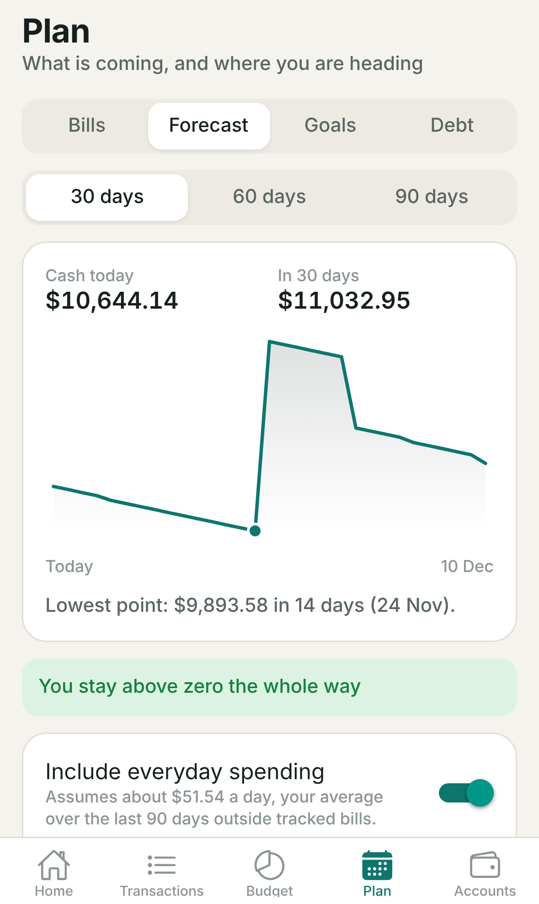

# Waypoint

A personal money tracker for iPhone. It covers what the best budgeting apps do (spending, budgets, bills, net worth,
goals) and is built around the things they tend to get wrong: it works with any bank in any currency, it plans ahead
instead of only looking back, and your data never leaves your phone.

<p>
  
  
  
  
</p>

Waypoint started as a study of [Copilot Money](https://copilot.money): what it does well and where its users say it
falls short. The findings, with sources, and how each one is addressed are in
[docs/copilot-teardown.md](docs/copilot-teardown.md). Waypoint is an original app, not a copy: it shares no code, name
or artwork with Copilot.

## What it does

- **Transactions.** Add by hand in a few taps, or import a CSV export from any bank. Search across payee, notes, tags
  and amounts; filter; select several and categorise them together; export exactly what you filtered.
- **Budget.** Category budgets with rollover. Change a budget for one month or from now on; past months never change.
  Track spending against limits, or switch to planning every unit of income.
- **Bills and income.** Weekly to yearly schedules, found in your history or added by hand. Mark paid or skip in two
  taps; payments that arrive later are matched automatically.
- **Forecast.** Your cash balance projected day by day for up to 90 days, with a warning before it runs short.
- **Goals and debt.** Savings goals that say how much to put aside each month, and a payoff plan for cards and loans.
- **Accounts and net worth.** Any mix of currencies, converted with rates you set.
- **Rules.** Tidy up transactions automatically, with every rule visible, editable and reorderable.
- **Your data.** Stored on the device only. One-file backup and restore. No account, no subscription.

## Run it

Developed and tested with Node 22.

```bash
npm install
npx expo start
```

- **On your iPhone:** install Expo Go from the App Store and scan the QR code. Phone and computer need to be on the
  same network.
- **In the iOS Simulator (Mac with Xcode):** press `i` in the terminal.
- **In a browser:** press `w`, or run `npm run web`.

On first launch choose "Explore with sample data" to see every screen populated with an invented household.

## Build it for iPhone

Building the installable app needs an Apple Developer account and happens in Expo's build service, so no Mac is
required:

```bash
npx eas-cli@latest build --platform ios --profile preview     # install on your own devices
npx eas-cli@latest build --platform ios --profile production  # for TestFlight and the App Store
```

Before the first build, change `ios.bundleIdentifier` in `app.json` from the placeholder `com.example.waypoint` to an
identifier you own. On a Mac you can also run `npx expo run:ios` to build locally.

## Test it

| Command | What it checks |
| --- | --- |
| `npm run typecheck` | TypeScript, strict mode |
| `npm run lint` | ESLint with Expo's rules |
| `npm test` | Over 300 Jest tests: all the money logic, the data store, and the whole app rendered through its real routes as it runs on iPhone |
| `npm run test:coverage` | The same, failing if the core logic drops below 90% coverage |
| `npm run build:ios-bundle` | The iPhone JavaScript bundle compiles |
| `npm run build:web && npm run e2e` | About 30 Playwright tests driving the real app at iPhone size: first run, transactions, budgets, bills, forecast, import, backup and restore |
| `npm run verify` | All of the above in order |

The first time, the browser tests need a browser: `npx playwright install chromium`.
`.github/workflows/ci.yml` runs the full set on every pull request.

What is not covered here: the app has not been run on a physical iPhone or in the iOS Simulator by these tests. Native
file sharing (exporting through the share sheet) and the system file picker are exercised only in their web form.

## How it is put together

```
src/
  domain/     Pure TypeScript with no React: money, dates, budgets, rules, recurring schedules,
              forecast, net worth, goals, debt, CSV import and export, backup. Fully unit tested.
  store/      The dataset and every operation on it as pure functions, wrapped in a Zustand store
              that saves to the device after each change.
  ui/         Theme, components, sheets, pickers and charts.
  features/   Screen sections shared between routes.
  app/        Screens. The file layout is the navigation (Expo Router).
e2e/          Playwright tests against the web build.
docs/         The Copilot study and screenshots.
```

Three decisions shape the code:

- **Money is integers.** Every amount is a whole number of the currency's minor unit, so there is no floating-point
  rounding anywhere. Splitting an amount across parts or months never loses or invents a cent.
- **Dates are calendar dates.** `"2026-11-10"`, with no time or timezone, so a transaction cannot move to another day
  when the clocks change or you travel.
- **The logic does not know about the screen.** Everything that decides a number lives in `src/domain` and is tested
  without rendering anything.

## Your data

Everything is stored on the device in the app's own storage. Nothing is sent anywhere; the app makes no network
requests of its own. That also means there is no automatic copy: use **Settings → Save a backup** now and then, and
before changing phone. If saved data ever cannot be read, the app says so and keeps the unreadable copy rather than
overwriting it.

## Known limits

- No live bank connection: transactions come in by hand or by CSV import.
- No investment holdings or live prices; an investment account is a balance you update.
- One device, one person: no sync and no shared household.
- Exchange rates are entered by hand.
- English only.

To regenerate the screenshots: `npm run build:web`, serve `dist` on port 4173, then `node scripts/screenshots.mjs`.
